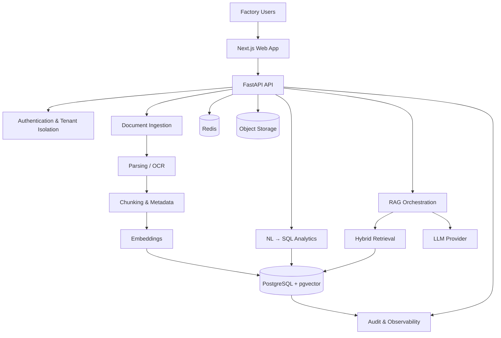

# Linora / MIOS — Manufacturing Intelligence OS

<p align="center">
  <strong>Turn factory data into decisions.</strong>
</p>

<p align="center">
  An AI-native intelligence layer for manufacturing operations, built around RAG, structured analytics, and multi-tenant SaaS architecture.
</p>

<p align="center">
  <a href="https://github.com/mnxtr/M_I_OS/stargazers"></a>
  <a href="https://github.com/mnxtr/M_I_OS/network/members"></a>
  <a href="https://github.com/mnxtr/M_I_OS/issues"></a>
</p>

> **Ask your factory anything.**
>
> MIOS connects documents, spreadsheets, production records, quality data, compliance evidence, and operational databases into one searchable intelligence layer. Instead of hunting through PDFs and Excel files, teams can ask questions in natural language and receive answers grounded in their own factory data.

---

## Project status

Linora is under active development. The repository contains a Next.js web app,
a FastAPI service, and database-backed ingestion and retrieval components.
Some capabilities described below are prototypes or planned work; a successful
build does not establish that authenticated workflows or tenant isolation are ready
for customer use. Use synthetic data until the release gates are met.

The [release-readiness checklist](docs/09-RELEASE-READINESS.md) records the
last reviewed deployment baseline and outstanding verification. A Vercel build has
previously been reported as ready, but its current configuration and authenticated
flows have not been verified in this setup. Supabase tenant isolation, API
connectivity, ingestion, payments, and recovery still require end-to-end checks.

---

## Why MIOS?

Manufacturing organizations rarely have a single clean source of truth. Operational knowledge is distributed across:

- 📄 SOPs and manuals
- 📊 Excel and CSV production sheets
- 🏭 Production and machine records
- 🔍 QC and defect reports
- 📋 Compliance and audit documents
- 💬 Operational messages and email attachments
- 🗄️ ERP and database records

Traditional software often forces factories to replace or restructure these systems before they can extract useful intelligence.

**MIOS takes the opposite approach:** connect the information factories already have, make it searchable, combine it with structured operational data, and put an intelligence layer on top.

---

## Product capabilities and direction

These are product capabilities and goals; implementation and verification vary
by feature. Check the roadmap and release-readiness checklist for current gates.

| Capability | What it does |
|---|---|
| **Knowledge Core** | RAG-powered search and Q&A across factory documents with source citations |
| **Production Intelligence** | Natural-language analytics over structured manufacturing data |
| **Compliance Copilot** | Find audit evidence, identify gaps, and accelerate corrective-action preparation |
| **Quality Intelligence** | Retrieve defect history, identify patterns, and support root-cause investigation |
| **Data Ingestion** | Ingest PDF, DOCX, TXT, Markdown, spreadsheets, images, and operational records |
| **Bilingual Intelligence** | English, Bangla, and Banglish query support |
| **Traceability** | Planned lot genealogy and product traceability capabilities |

### Example questions

```text
"Which production line had the highest downtime last month?"

"Show total output by line for order 4821."

"What caused the recurring defects in Line 7?"

"Find the SOP that covers needle-change procedures."

"Which documents provide evidence for this buyer audit requirement?"

"Line 7 er output koto chilo last week?"
```

The goal is not another chatbot. The goal is an **operational intelligence system** that can connect an answer to the underlying factory evidence.

---

## Architecture

The diagram describes the intended architecture. The web and API currently have
separate retrieval paths, and the full flow requires integration verification.



### RAG pipeline

```text
Documents / Records
        │
        ▼
   Ingestion Layer
        │
        ├── PDF / DOCX / TXT / MD
        ├── XLSX / XLSM / CSV
        └── Images → OCR
        │
        ▼
Parsing + Normalization
        │
        ▼
Chunking + Metadata
        │
        ▼
Embeddings
        │
        ▼
PostgreSQL + pgvector
        │
        ▼
Query Expansion
        │
        ▼
Hybrid / Multi-Variant Retrieval
        │
        ▼
Context Assembly
        │
        ▼
LLM Generation
        │
        ▼
Cited Answer
```

---

## Product architecture

MIOS is designed as a **multi-tenant SaaS platform**.

```text
Tenant
 ├── Factory
 │    ├── Users & Roles
 │    ├── Documents
 │    ├── Data Tables
 │    ├── Production Records
 │    ├── Quality Records
 │    ├── Compliance Records
 │    └── Conversations
 │
 └── Intelligence Layer
      ├── Retrieval
      ├── Analytics
      ├── Citations
      └── Audit Logs
```

Tenant isolation is treated as a core architectural requirement rather than a UI feature. Database access is designed around PostgreSQL row-level security and explicit tenant context.

---

## Technology stack

### Application

- **Frontend:** Next.js / React / TypeScript
- **Backend:** Python / FastAPI
- **Database:** PostgreSQL / Supabase
- **Vector search:** pgvector
- **Cache / queue:** Redis
- **Background processing:** Celery / FastAPI background tasks
- **Object storage:** Supabase Storage and local development storage

### AI

- Retrieval-augmented generation (RAG)
- Embedding-based semantic search
- Query expansion and retrieval fusion
- Natural-language-to-SQL analytics
- OCR-assisted document ingestion
- Pluggable LLM and embedding providers

### Infrastructure

- Docker Compose for local development
- Vercel-compatible web deployment architecture
- PostgreSQL-compatible production database
- CI-ready evaluation and regression testing

---

## Repository structure

```text
M_I_OS/
├── apps/
│   ├── api/                         # FastAPI backend and intelligence services
│   └── web/                         # Next.js frontend
│
├── packages/
│   └── shared/                      # Shared types, schemas, and contracts
│
├── docs/
│   ├── 01-VISION-AND-PRODUCT.md    # Product vision, users, and modules
│   ├── 02-ARCHITECTURE.md           # System architecture
│   ├── 03-RAG-DESIGN.md             # Retrieval and ingestion design
│   ├── 04-DEVELOPMENT-PLAN.md       # Development roadmap
│   ├── 05-BANGLADESH-GTM.md         # Market and go-to-market strategy
│   └── adr/                          # Architecture decision records
│
├── evals/                            # Retrieval evaluation datasets and runners
├── infra/
│   └── docker-compose.yml            # Local infrastructure
│
└── README.md
```

## GitHub Pages

GitHub Pages is configured through `.github/workflows/deploy-pages.yml`. Each push to
`main` builds and deploys the static MIOS public site from `apps/web/github-pages/`.

The authenticated workspace remains a server-rendered Next.js application with API
routes, cookies, and server actions, so it must be deployed on a server-capable host
alongside the FastAPI service. GitHub Pages is used for the public product surface.

---

## Quick start

### Prerequisites

- Python 3.11+
- Node.js 22+ (the workspace engine requirement)
- PostgreSQL 16 with pgvector, or Docker + Docker Compose for the supplied local stack
- Git
- A separate development Supabase environment for authenticated end-to-end flows

Optional for full AI functionality:

- An LLM provider API key
- An embedding provider API key
- Tesseract OCR for scanned documents

### 1. Clone the repository

```bash
git clone https://github.com/mnxtr/M_I_OS.git
cd M_I_OS
```

### 2. Start local infrastructure

The supplied Docker Compose configuration starts PostgreSQL with pgvector, Redis,
and MinIO:

```bash
docker compose -f infra/docker-compose.yml up -d
```

Alternatively, run PostgreSQL 16 with pgvector natively and set `DATABASE_URL`
in `apps/api/.env` to your isolated development database. The database alone
does not provide Supabase Auth, Storage, or the Supabase APIs. Redis is needed
when Celery is enabled; the API can use local storage for development.

Use a dedicated development database. Do not bootstrap or seed a shared or
production database.

### 3. Start the API

```bash
cd apps/api
python3 -m venv .venv
source .venv/bin/activate
pip install -e ".[dev]"
cp .env.example .env
```

Edit `apps/api/.env` for your development database and Supabase project, then
start the API from `apps/api`:

```bash
uvicorn app.main:app --reload --port 8000
```

The example leaves `DB_BOOTSTRAP=false` and `CREATE_VECTOR_EXTENSION=false`;
the API health endpoint can start without initializing a database. For a **new,
isolated development database only**, bootstrap the schema and pgvector on startup
by setting both flags to `true`; the database role must have the required
privileges. Turn them off again after initialization. This bootstrap is not a
production migration procedure.

### 4. Start the web application

```bash
cd ../..  # from apps/api
cp apps/web/.env.example apps/web/.env.local
npm ci
npm run dev
```

After returning to the repository root, populate `apps/web/.env.local` with
your development Supabase URL and publishable key; configure the API origin and
site URL to match your environment. Configure a server-only Supabase secret key
only where features such as signed uploads require it. Never put secret keys in
`NEXT_PUBLIC_*` variables or commit environment files.

Open:

```text
http://localhost:3000
```

### 5. Configure AI providers

For full-quality generation and embeddings, configure the provider settings in `apps/api/.env`.
The API imports the OpenAI or Anthropic SDK when the corresponding provider is
enabled; these SDKs are not included in the base API dependencies and must be
installed separately for those paths.

```env
EMBEDDING_PROVIDER=openai
LLM_PROVIDER=openai
```

For API development, `EMBEDDING_PROVIDER=local` and `LLM_PROVIDER=none` use
deterministic local embeddings and extractive responses. These fallbacks are useful
for testing plumbing, not for evaluating production answer quality. Web features
may have separate provider settings; see `apps/web/.env.example`.

---

## Supported data

### Documents

- PDF
- DOCX
- TXT
- Markdown
- Scanned documents via OCR
- PNG / JPG images

### Structured data

- CSV
- XLSX
- XLSM
- PostgreSQL-compatible operational data

Spreadsheet ingestion can expose uploaded data as queryable tables for natural-language analytics.

---

## Natural-language analytics

MIOS can translate operational questions into constrained, read-only SQL queries.

Example:

```text
User:
"What was the total output for each production line last month?"

        ↓

Intent + schema discovery
        ↓

NL → SQL generation
        ↓

SQL validation / guardrails
        ↓

Read-only execution
        ↓

Result + explanation
```

Analytics execution is designed with guardrails such as:

- Read-only database access
- Statement timeouts
- Query limits
- Schema-aware generation
- Tenant-scoped data access

Never expose unrestricted database credentials to an LLM-generated query path.

---

## Bilingual search

MIOS is designed for real-world factory communication, where users may switch between English, Bangla, and Banglish in the same workflow.

Examples:

```text
English:
"What was Line 7's output yesterday?"

Bangla:
"গতকাল লাইন ৭ এর উৎপাদন কত ছিল?"

Banglish:
"line 7 er output koto chilo?"
```

The retrieval layer can use query expansion and multi-variant retrieval to improve recall across these forms.

---

## Retrieval evaluation

MIOS includes a retrieval evaluation workflow intended to catch regressions as the RAG pipeline evolves.

The evaluation framework tracks metrics such as:

- Hit@K
- Mean Reciprocal Rank (MRR)
- Retrieval regression against a baseline

Example:

```bash
MIOS_TEST_DSN=... \
MIOS_EVAL_TENANT_ID=... \
python evals/run_eval.py
```

The objective is simple: **RAG quality should be measured, not declared by vibes.**

---

## Background processing

For development, ingestion can run inline through FastAPI background tasks.

For larger deployments, enable Celery workers:

```bash
cd apps/api
pip install -e ".[worker]"
```

Set `USE_CELERY=true` in the API environment, configure Redis, and then run:

```bash
celery -A app.worker worker -l info
```

This allows document ingestion and other long-running workloads to move out of the request lifecycle.

---

## Email ingestion

MIOS can ingest factory information delivered through email workflows.

A typical flow is:

```text
Factory mailbox
      ↓
Inbound connector
      ↓
Secret validation
      ↓
MIME + attachment extraction
      ↓
Document classification
      ↓
RAG ingestion
      ↓
Searchable factory knowledge
```

Attachments such as PDF, XLSX, DOCX, and images can be routed through the same ingestion pipeline.

---

## Security principles

Manufacturing data can contain commercially sensitive information, employee records, buyer information, and compliance evidence. MIOS therefore treats security as part of the product architecture.

Key principles:

- **Tenant isolation** at the database layer
- **Least-privilege database access**
- **Read-only analytics execution**
- **Validated SQL generation**
- **Audit logging** for sensitive operations
- **Secrets stored outside source control**
- **Provider abstraction** to reduce unnecessary data exposure
- **Source citations** so users can inspect the evidence behind answers

Production deployments should additionally implement appropriate encryption, secret management, network controls, backups, monitoring, retention policies, and access reviews.

---

## Development

### Run tests

```bash
# API, from the repository root
cd apps/api
.venv/bin/python -m pytest

# Web, from the repository root
cd ../..
npm run test
npm run typecheck
```

Database-dependent API tests are skipped unless `MIOS_TEST_DSN` is set. Set
`DATABASE_URL` and `MIOS_TEST_DSN` before starting the test process and point
both to the same **dedicated test database**. Never use a production or shared
database for test fixtures.

In a local run on 1 November 2026, 101 API tests passed and the database-backed
legacy registration test failed when inserting a user with a null tenant ID.
Legacy authentication is retained for migration tests; this result does not
verify or disprove Supabase Auth. The web suite passed 21 tests and type-checking
passed. These results are a point-in-time baseline, not production acceptance.

### Lint

```bash
cd apps/api
.venv/bin/ruff check app tests
```

### Recommended development workflow

```text
Issue
  ↓
Design / ADR
  ↓
Implementation
  ↓
Unit tests
  ↓
Integration tests
  ↓
RAG evaluation
  ↓
Security review
  ↓
Pull request
```

---

## Roadmap

### Phase 1 — Intelligence Core

Items below describe implemented foundations, not completed release gates.

- [x] Multi-tenant foundation
- [x] Document ingestion architecture
- [x] RAG pipeline foundation
- [x] Citation-aware answers
- [x] Spreadsheet ingestion
- [x] Natural-language analytics architecture
- [x] Bangla / Banglish retrieval design

### Phase 2 — Factory Intelligence

- [ ] Production KPI dashboards
- [ ] OEE intelligence
- [ ] Downtime analysis
- [ ] Quality intelligence
- [ ] Compliance evidence workspace
- [ ] Automated corrective-action workflows

### Phase 3 — Operational Platform

- [ ] ERP connectors
- [ ] Machine / IoT connectors
- [ ] Advanced traceability
- [ ] Lot genealogy
- [ ] Buyer-facing compliance exports
- [ ] Enterprise deployment controls

### Phase 4 — Manufacturing Intelligence Network

- [ ] Cross-site benchmarking with privacy controls
- [ ] Predictive operational intelligence
- [ ] Supply-chain intelligence
- [ ] Digital Product Passport-ready workflows

---

## Product thesis

> **Factories should not need to replace their existing software before they can benefit from AI.**

MIOS is designed as an intelligence layer that sits above the systems factories already use.

The initial wedge is compliance and operational knowledge, where information is often fragmented across documents, spreadsheets, and historical records. From there, the platform expands into production analytics, quality intelligence, traceability, and broader factory operations.

---

## Target market

The initial market focus is Bangladesh's manufacturing sector, particularly export-oriented factories where operational data, compliance requirements, and buyer expectations create a strong need for better information access.

Initial beachhead:

- Ready-made garments (RMG)
- Mid-sized export factories
- Factories operating across multiple production lines
- Organizations with significant document and spreadsheet workflows
- Suppliers exposed to international buyer compliance requirements

The architecture is intentionally broader than RMG and can extend to food, pharmaceuticals, leather, electronics, and other manufacturing verticals.

---

## Contributing

Contributions, issues, architecture discussions, and practical manufacturing use cases are welcome.

Before opening a pull request:

1. Read the relevant architecture documentation.
2. Add or update tests for behavioral changes.
3. Run linting and the relevant evaluation suite.
4. Document significant architectural decisions in `docs/adr/`.
5. Keep tenant isolation and data security in mind when changing data access paths.

---

## License

License information will be added when the project license is finalized.

Until then, the repository should not be treated as granting broad permission to redistribute or commercially reuse the code.

---

## Links

- **Repository:** https://github.com/mnxtr/M_I_OS
- **Issues:** https://github.com/mnxtr/M_I_OS/issues
- **Discussions:** https://github.com/mnxtr/M_I_OS/discussions

---

<p align="center">
  Built to make factory data useful.<br>
  <strong>MIOS — Manufacturing Intelligence OS</strong>
</p>
